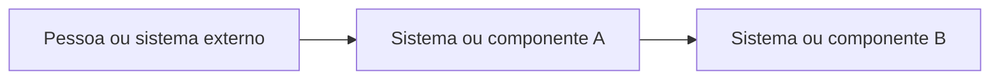

# ADR-[número]: [Título da decisão]

- **Status:** Proposta | Aceita | Rejeitada | Depreciada | Substituída
- **Data de criação:** [AAAA-MM-DD]
- **Data de aprovação:** [AAAA-MM-DD ou "Não se aplica"]
- **Data de vigência:** [AAAA-MM-DD ou "Não se aplica"]
- **Decisores:** [Pessoa ou grupo responsável pela decisão]
- **Responsável pelo registro:** [Nome e equipe]
- **RFC de origem:** [Link ou "Não se aplica"]
- **ADRs relacionadas:** [Links ou "Nenhuma"]
- **Planos de desenvolvimento:** [Links ou "Ainda não criado"]
- **Repositórios ou sistemas afetados:** [Sistemas, serviços ou componentes]

> **Como preencher:** Use um identificador sequencial ou o padrão adotado pela equipe. O título deve descrever a decisão, e não apenas o assunto. Atualize o status quando a decisão mudar.

## 1. Contexto

[Descreva a situação que exige uma decisão arquitetural. Inclua o problema, as necessidades, as restrições e as informações relevantes para entender o cenário.]

> **Como preencher:** Registre fatos e requisitos, como escala, desempenho, segurança, custos, compatibilidade, prazo e limitações técnicas. Evite incluir a solução escolhida nesta seção.

## 2. Problema ou questão

[Formule claramente a pergunta que precisa ser respondida ou o problema que precisa ser resolvido.]

> **Como preencher:** Escreva uma pergunta objetiva, por exemplo: "Como devemos armazenar os eventos para permitir reprocessamento e auditoria?" Isso ajuda a manter a decisão dentro do escopo.

## 3. Requisitos e critérios de decisão

- [Requisito funcional ou técnico 1]
- [Requisito funcional ou técnico 2]
- [Restrição obrigatória]
- [Critério usado para comparar alternativas]

> **Como preencher:** Diferencie o que é obrigatório do que é desejável. Sempre que possível, transforme critérios em medidas verificáveis, como latência, disponibilidade, custo ou prazo.

## 4. Decisão

[Registre de forma direta a decisão tomada, incluindo a opção escolhida e seu escopo.]

> **Como preencher:** Esta seção deve permitir que alguém identifique a decisão em poucos segundos. Não deixe a decisão implícita no meio da justificativa.

## 5. Detalhes da solução

[Explique como a decisão será aplicada na arquitetura e quais componentes, fluxos, interfaces ou processos serão afetados.]

### 5.1 Visão técnica

[Descreva os principais componentes e suas responsabilidades.]

### 5.2 Fluxo ou diagrama

Para decisões com representação arquitetural complexa, use o C4 Model nesta ordem:

1. **Contexto:** sistema, usuários e sistemas externos.
2. **Containers:** aplicações, serviços, bancos de dados e demais unidades executáveis.
3. **Componentes:** principais responsabilidades dentro de um container.
4. **Código:** use somente quando um detalhe interno for indispensável para a decisão.

Priorize as três primeiras camadas e evite detalhar a camada de Código. Use Mermaid ou outro diagrama versionável no repositório. Para fluxos simples, um diagrama ASCII é suficiente.

### 5.3 Exemplo

[Inclua um exemplo de configuração, fluxo de dados, chamada de API ou uso que torne a decisão concreta.]

> **Como preencher:** Inclua detalhes suficientes para orientar implementação e revisão, mas não transforme o ADR em uma especificação completa. Documente aqui apenas os aspectos diretamente relacionados à decisão.

## 6. Alternativas consideradas

### Alternativa A: [Nome]

- **Descrição:** [Como funciona]
- **Vantagens:** [Benefícios]
- **Desvantagens:** [Custos, riscos ou limitações]
- **Motivo para não escolher:** [Justificativa]

### Alternativa B: [Nome]

- **Descrição:** [Como funciona]
- **Vantagens:** [Benefícios]
- **Desvantagens:** [Custos, riscos ou limitações]
- **Motivo para não escolher:** [Justificativa]

### Manter o estado atual

[Explique por que continuar como está foi ou não considerado uma alternativa válida.]

> **Como preencher:** Registre alternativas reais, inclusive as que parecem menos adequadas. A comparação mostra que a decisão foi consciente e evita reabrir discussões já resolvidas sem novas informações.

## 7. Consequências

### Benefícios

- [Benefício obtido com a decisão]
- [Melhoria esperada]

### Custos e impactos

- [Custo de implementação ou operação]
- [Complexidade ou dependência adicionada]
- [Impacto em usuários, equipes ou sistemas]

### Riscos e limitações

- [Risco conhecido]
- [Limitação que deve ser aceita]
- [Condição que pode exigir revisão futura]

> **Como preencher:** Registre consequências positivas e negativas. Uma decisão arquitetural raramente elimina todos os trade-offs; documentá-los torna a escolha mais honesta e útil no futuro.

## 8. Segurança, privacidade e conformidade

[Descreva como a decisão afeta autenticação, autorização, dados sensíveis, auditoria, retenção e requisitos legais ou internos.]

- **Dados envolvidos:** [Tipos de dados e classificação]
- **Ameaças relevantes:** [Cenários de abuso ou exposição]
- **Controles necessários:** [Mitigações e salvaguardas]
- **Revisões necessárias:** [Segurança, privacidade, jurídico ou compliance]

> **Como preencher:** Se a decisão não tiver impacto identificado, registre explicitamente essa avaliação e sua justificativa.

## 9. Execução da decisão

- **Plano de desenvolvimento:** [Link para o plano detalhado ou "Ainda não criado"]
- **Dependências relevantes:** [Decisões, equipes, sistemas ou fornecedores]
- **Estratégia de adoção:** [Como a decisão será aplicada em alto nível]
- **Rollback:** [Estratégia em alto nível ou "Não se aplica"]

> **Como preencher:** Registre aqui apenas o necessário para entender a adoção da decisão. Detalhe atividades, sequência, comandos, responsáveis e evidências em um plano de desenvolvimento.

## 10. Critérios de sucesso da decisão

- [ ] [Requisito arquitetural atendido]
- [ ] [Compatibilidade ou limite técnico preservado]
- [ ] [Métrica ou meta operacional que justifica a decisão]
- [ ] [Condição que indica que a decisão deve ser reavaliada]

> **Como preencher:** Defina resultados técnicos que demonstrem que a decisão é adequada e continua válida. Os testes, comandos e evidências para obtê-los devem estar no plano de desenvolvimento.

## 11. Monitoramento e revisão

- **Métricas:** [Indicadores acompanhados]
- **Logs e auditoria:** [Eventos registrados]
- **Alertas:** [Condições que exigem ação]
- **Data de revisão:** [AAAA-MM-DD ou "Quando necessário"]
- **Gatilhos para reavaliar:** [Mudanças, falhas ou métricas que justificam nova decisão]

> **Como preencher:** Nem toda decisão precisa de uma data fixa de revisão. Sempre registre os sinais que indicariam que a decisão deixou de ser adequada.

## 12. Questões em aberto

- [ ] [Questão pendente que não impede a decisão]
- [ ] [Informação que precisa ser confirmada]

> **Como preencher:** Use esta seção apenas para pendências relacionadas à decisão. Remova itens resolvidos ou registre sua resolução no histórico.

## 13. Histórico

| Data | Alteração | Motivo | Responsável |
|---|---|---|---|
| [AAAA-MM-DD] | [Descrição da alteração] | [Motivo] | [Nome] |

> **Como preencher:** Preserve as mudanças relevantes no documento. Se a decisão for substituída, mantenha este ADR como registro histórico e aponte para o novo ADR.

## 14. Referências

- [Link para documentação, RFC, ticket, pesquisa ou decisão relacionada]
- [Link para diagrama, benchmark ou protótipo]

> **Como preencher:** Adicione somente referências que sustentem o contexto, a decisão ou a implementação. Verifique se os links estão acessíveis para os revisores.
