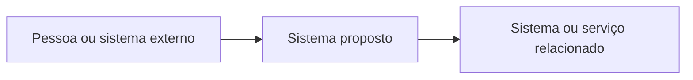

# RFC-[número]: [Título da proposta]

- **Status:** Rascunho | Em revisão | Aprovada | Rejeitada | Em implementação | Implementada | Arquivada
- **Autor(es):** [Nome(s) e equipe]
- **Data de criação:** [AAAA-MM-DD]
- **Última atualização:** [AAAA-MM-DD]
- **Data de aprovação:** [AAAA-MM-DD ou "Não se aplica"]
- **Data de implementação:** [AAAA-MM-DD ou "Não se aplica"]
- **Revisores:** [Pessoas responsáveis pela revisão]
- **Decisores:** [Pessoa ou grupo responsável pela decisão]
- **ADRs relacionadas:** [Links ou "Nenhuma"]
- **Planos de desenvolvimento:** [Links ou "Ainda não criado"]
- **Referências:** [Tickets, protótipos, pesquisas ou PRs]

> **Como preencher:** Atualize os metadados acima sempre que o documento mudar de fase ou houver alteração relevante na proposta. O título deve ser curto e identificar claramente o tema da RFC.

## 1. Resumo

[Descreva a proposta em poucas frases, incluindo o que será alterado e o resultado esperado.]

> **Como preencher:** Escreva esta seção por último. Uma pessoa deve conseguir entender a ideia principal sem ler o documento inteiro.

## 2. Contexto

[Explique o cenário atual, os usuários ou sistemas envolvidos e os fatos que motivaram esta RFC.]

> **Como preencher:** Inclua dados, métricas, exemplos ou referências que ajudem a entender o contexto. Evite apresentar a solução antes de explicar o problema.

## 3. Problema

[Defina o problema que precisa ser resolvido e quem é afetado por ele.]

- **Problema principal:** [Descrição objetiva]
- **Público afetado:** [Usuários, equipes ou sistemas]
- **Frequência ou impacto atual:** [Dados, exemplos ou consequências]

> **Como preencher:** Formule o problema de maneira verificável. Diferencie sintomas, causas conhecidas e restrições existentes.

## 4. Objetivos e não objetivos

### 4.1 Objetivos

- [Objetivo mensurável 1]
- [Objetivo mensurável 2]
- [Objetivo mensurável 3]

### 4.2 Não objetivos

- [O que explicitamente não será resolvido nesta RFC]
- [Escopo deixado para uma etapa futura]

> **Como preencher:** Liste resultados, não tarefas. Os não objetivos ajudam a evitar que o escopo cresça durante a revisão.

## 5. Proposta

[Descreva a solução recomendada em detalhes suficientes para que possa ser revisada e implementada.]

### 5.1 Funcionamento

[Explique o fluxo principal, as regras de negócio e as interações entre componentes ou equipes.]

### 5.2 Arquitetura ou desenho técnico

[Inclua diagramas, modelos de dados, endpoints, interfaces ou exemplos de configuração, quando aplicável.]

Para representações complexas, use o C4 Model nesta ordem:

1. **Contexto:** sistema, usuários e sistemas externos.
2. **Containers:** aplicações, serviços, bancos de dados e demais unidades executáveis.
3. **Componentes:** principais responsabilidades dentro de um container.
4. **Código:** use somente quando um detalhe interno for indispensável para a decisão.

Priorize as três primeiras camadas e não detalhe a camada de Código sem necessidade explícita. Use Mermaid ou outro diagrama versionável no repositório. Para fluxos simples, um diagrama ASCII é suficiente.

### 5.3 Exemplo de uso

[Mostre um ou mais exemplos de entrada, fluxo e resultado esperado.]

> **Como preencher:** Detalhe primeiro o comportamento observável. Inclua apenas decisões técnicas necessárias para avaliar a proposta; deixe escolhas de implementação menores para a etapa de execução.

## 6. Alternativas consideradas

| Alternativa | Vantagens | Desvantagens | Motivo da decisão |
|---|---|---|---|
| [Opção A] | [Vantagens] | [Desvantagens] | [Por que foi escolhida ou descartada] |
| [Opção B] | [Vantagens] | [Desvantagens] | [Por que foi escolhida ou descartada] |

> **Como preencher:** Registre opções reais que foram avaliadas, incluindo manter o estado atual quando isso for plausível. Explique os critérios usados para comparar as alternativas.

## 7. Impactos e trade-offs

- **Benefícios esperados:** [Ganhos para usuários, negócio ou operação]
- **Custos:** [Desenvolvimento, infraestrutura, licenças ou manutenção]
- **Complexidade adicionada:** [Componentes, processos ou dependências]
- **Riscos aceitos:** [Riscos conhecidos e justificativa]
- **Compatibilidade:** [Efeito sobre integrações e versões existentes]

> **Como preencher:** Seja explícito sobre o que melhora e o que fica pior. Uma proposta fica mais confiável quando seus custos e limitações também estão documentados.

## 8. Segurança, privacidade e conformidade

[Descreva os impactos sobre autenticação, autorização, dados sensíveis, auditoria, retenção e requisitos legais ou internos.]

- **Dados envolvidos:** [Tipos de dados e classificação]
- **Ameaças ou abusos possíveis:** [Cenários relevantes]
- **Mitigações:** [Controles planejados]
- **Revisões necessárias:** [Segurança, jurídico, privacidade ou compliance]

> **Como preencher:** Se não houver impacto, escreva explicitamente "Sem impacto identificado" e justifique brevemente a avaliação.

## 9. Execução

- **Plano de desenvolvimento:** [Link para o plano detalhado ou "Ainda não criado"]
- **Dependências relevantes:** [Times, sistemas, fornecedores ou decisões necessárias]
- **Migração ou ativação:** [Estratégia em alto nível ou "Não se aplica"]
- **Rollback:** [Estratégia em alto nível ou "Não se aplica"]

> **Como preencher:** Registre nesta RFC somente a estratégia de alto nível necessária para avaliar a proposta. Detalhe atividades, sequência, comandos, responsáveis e evidências em um plano de desenvolvimento.

## 10. Critérios de sucesso

- [ ] [Resultado de negócio ou comportamento observável 1]
- [ ] [Resultado de negócio ou comportamento observável 2]
- [ ] [Limite, risco ou condição que deve ser respeitado]
- [ ] [Indicador de sucesso ou condição de adoção]

> **Como preencher:** Registre resultados em nível de proposta, verificáveis após a implementação. Detalhe cenários, testes, comandos e evidências no plano de desenvolvimento.

## 11. Observabilidade e operação

- **Métricas:** [Indicadores que serão acompanhados]
- **Logs e auditoria:** [Eventos registrados e retenção]
- **Alertas:** [Condições que exigem ação]
- **Runbook ou suporte:** [Procedimentos e responsáveis]
- **SLOs ou metas:** [Disponibilidade, latência ou qualidade esperada]

> **Como preencher:** Explique como saberemos que a mudança funciona em produção e como investigar problemas após a implantação.

## 12. Plano de comunicação

[Liste as pessoas ou equipes que precisam ser informadas, o momento da comunicação e o canal utilizado.]

| Público | Mensagem | Quando | Canal | Responsável |
|---|---|---|---|---|
| [Equipe ou grupo] | [Mensagem principal] | [Data ou etapa] | [Canal] | [Nome] |

> **Como preencher:** Inclua comunicação para usuários, suporte, operações e demais dependentes afetados pela mudança.

## 13. Questões em aberto

- [ ] [Pergunta ou decisão pendente 1]
- [ ] [Pergunta ou decisão pendente 2]

> **Como preencher:** Registre dúvidas que impedem a aprovação ou podem alterar a solução. Remova os itens resolvidos ou mova-os para o histórico de decisões.

## 14. Decisão

- **Decisão:** [Aprovada | Aprovada com condições | Rejeitada | Adiada]
- **Data:** [AAAA-MM-DD]
- **Responsável:** [Nome ou grupo]
- **Justificativa:** [Resumo dos motivos da decisão]

> **Como preencher:** Preencha esta seção somente após a revisão. Se a decisão mudar, preserve o histórico na seção seguinte.

## 15. Histórico de decisões e alterações

| Data | Decisão ou alteração | Motivo | Responsável |
|---|---|---|---|
| [AAAA-MM-DD] | [Descrição] | [Motivo] | [Nome] |

> **Como preencher:** Use esta tabela para manter rastreabilidade das mudanças relevantes feitas durante a revisão e a implementação.
